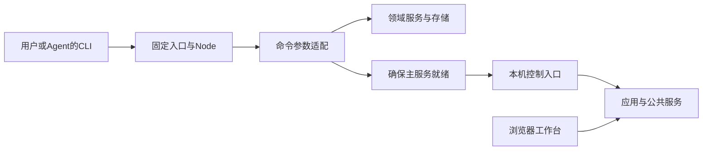

# 从CLI到人机协作的完整调用链

本章以当前实现解释各层连接。概念组成见[立字模型](overview.md)，精确程序契约见各参考页。

## 1. 固定入口与运行时

用户或Agent调用.agents/ksf（macOS）或.agents/ksf.ps1（Windows）。入口按自身位置定位实例，先恢复已发起但中断的事务，再转交Core bootstrap；bootstrap核对声明与摘要，准备随包Node并运行cli.js。

launcher recover可以在Core或Node不可用时处理既有事务。普通启动不检查远程版本、不自动升级，也不选择全局Node。两个平台共享业务JavaScript，原生进程、路径、文件替换和系统服务由平台适配。

## 2. CLI与公共服务

查询、对象维护等可直接使用领域服务；需要运行宿主的应用业务与通信命令先确保主服务。状态、日志和离线检查不启动后台。命令的JSON信封与错误通道按实际契约核对，bootstrap失败不保证已经生成业务JSON。

## 3. 主服务、界面与应用

主服务统一托管应用、通信、AI、会话和资源清理。浏览器只是客户端，前端资源损坏应返回明确错误，管理API和后台继续运行。默认回环端口1313；并发入口核对实例根、进程启动身份和随机标识，协调唯一服务。

应用同版本共享后台，窗口和卡片保留独立租约与临时状态。按需、常驻、任务租约和持久保活表达不同运行需求，平台不接管业务工作流。显式停止策略优先于新的界面、CLI或消息激活。

## 4. Agent的职责路径

AGENTS → context entry（首次孵化或正常runtime）→ 按需项目事实与能力选择 → 正文/依赖/资料 → 已授权执行 → 结果核对与保存。语义判断由Agent完成，CLI负责列举、读取和结构核验。读取搭档不创建独立Agent，Cooperation也不是程序DAG。

项目、知识、能力、档案表达内容用途，程序配置及本机状态另外保存。能力源直接读取已关联Git工作树，个人覆盖、精确引用与固定保护由对象解析负责。

## 5. 状态与并发

支持版本条件的写入通常经过读取基线、校验、获取锁、重核版本、同目录暂存和原子发布。etag/revision管理相应记录的竞争；稳定操作ID支持幂等和对账。普通Markdown编辑及外部系统不自动继承同一保护。

单文件原子发布不是任意跨文件事务，原件备份不是自动数据降级。进程中断测试也不能替代全部断电、磁盘和长期运行验证。存储所有权见[数据地图](../reference/data-map.md)。

## 6. AI与通信

应用AI提交明确材料及执行快照；Core持有队列、尝试和成功结果校验。原生Desktop持有持久线程，Core只保存必要关联与操作回执。未知结果使用原ID核对，不自动改模型重做。

通信通过节点证书、mTLS、端点授权和受管材料进行投递。收到原件、应用接管与业务完成分开，接收方保持本地自主决定。自动启动后端不意味着授权远程执行。

## 7. 演进与维护

Core构建把源码、包与摘要形成可核验资产；正式发行与本机开发构建分别表达。升级先检查数据和应用兼容，再按事务切换；回滚程序不自动恢复业务数据。用户内容不进入Core包。

修改跨层行为时核对所有者、消费者、状态、失败和恢复，使用相应契约及真实平台验证。[系统架构](../system/README.md)、[平台](../runtime/platforms.md)、[发行](../distribution.md)提供详细依据。
