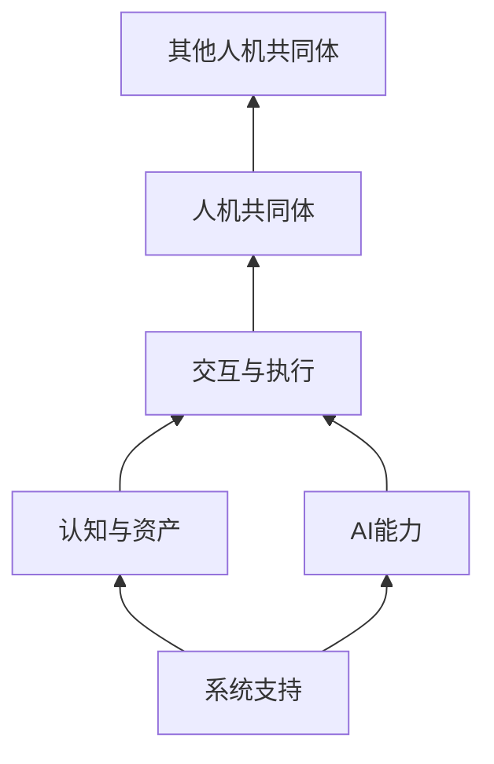

# 理解 KSF：定位、组成与进化飞轮

KSF 是以人为主体，将认知资产、AI能力、实际工作和跨实例协作连接起来，使人与AI能够持续工作、积累和改进的协作框架。它可以从一个文件夹中的真实项目开始，并逐步使用工作台、应用和通信能力。

## 四个目标

1. 人的认知沉淀：保存认识、事实、依据和适用条件，允许检验、反驳和修订。
2. AI能力沉淀：把可复用的责任、方法、操作和资料组织方式保存为能力。
3. 人与AI协作飞轮：将能力投入工作，根据结果与反馈修订，再在后续工作中验证。
4. 整体之间协作：人和AI作为整体参与外部合作，明确输入、责任、交付和验收。

这些目标是评价系统的方向。长期效率、交付质量和认知改善需要独立证据，不能从安装或测试成功推定。

## 人、Agent与程序

| 参与者 | 持有的责任 | 可核验依据 |
| --- | --- | --- |
| 人 | 目标、价值取舍、采纳、长期修订和有效授权 | 明确要求、决定与验收 |
| Agent | 理解、准备上下文、选择能力、推进、判断、纠偏和检查 | 实际采用的定义、操作及产物 |
| 程序 | 确定性读写、校验、进程、投递、版本和恢复 | 文件、状态、回执及测试 |

Agent由宿主提供。KSF搭档是供Agent采用的职责定义，读取搭档不会创建另一个Agent。宿主的权限和工具约束继续有效；能力、资料或远程消息都不会扩展授权。

## 立字模型

| 笔画 | 组成 | 核心问题 |
| --- | --- | --- |
| 底横 | 系统支持 | 怎样可靠运行、保护资产和恢复工作？ |
| 左点 | 认知与资产 | 知道什么、依据是什么、正在做什么、留下什么？ |
| 右撇 | AI能力 | 有哪些可复用的工作方式，怎样维护和改进？ |
| 上横 | 交互与执行 | 怎样把人的意图推进到可核验结果？ |
| 顶点 | 人机共同体 | 整体是谁、能做什么、怎样与其他整体合作？ |

前四笔展开内部组成，顶点表达整体及对外协作。模型不规定软件必须逐层调用，也不要求目录按笔画搬迁。技术调用关系见[完整调用链](architecture.md)。

图中箭头表达支持和参与关系，不表示进程或网络协议。

## 飞轮怎样发生

认知与资产支持能力和当前工作 → 能力投入实际工作 → 工作产生结果与反馈 → 人复盘并修订认知和能力 → 在下一次工作中验证。

例如项目发现“提交不等于审核通过”，可以修订项目状态说明；将“先识别各自完成条件”形成可复用设计方法，则属于另一次能力设计。应用代码改动、知识修订和能力修改分别确认，不能混称一次“自动进化”。

检查一轮积累：保存了什么、改变了什么、后来用在哪里、效果怎样。并非每次工作都需要长期沉淀，知识也不必转成能力。[完整案例](examples.md)展示各环节的产物和检查。

## 适用方式与边界

适合持续维护项目背景、专业方法和成果的人。一次性问答可以无项目、无专用能力；空用户目录也是正常状态。默认一设备一个实例，多窗口和CLI复用公共服务。

KSF不提供通用自动知识采纳、模型训练、任意文件跨文件事务、不可信应用沙箱或任意网络下离线转发。已有公共机制及其边界见[版本与支持](../reference/compatibility.md)。
