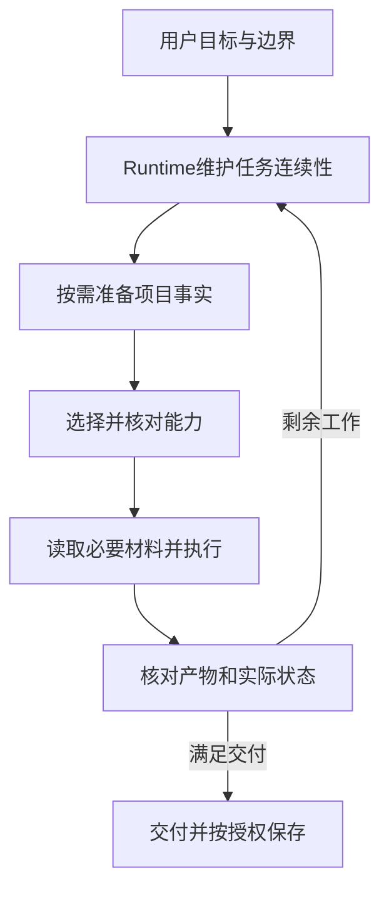

# 一项任务怎样推进、纠偏和恢复

本章解释Agent的工作过程。运行定义由AGENTS及其实际解析的runtime和基本功持有；CLI提供确定性操作，不在后台自动运行搭档。

## 入口与上下文

宿主Agent读取根AGENTS.md，通过context entry取得孵化或正常工作要求；进入正常runtime后，完整读取USER、BOT。runtime判断本轮是新任务、继续、旁问、纠正、暂停还是取消，保留仍有效目标和成果。

有项目需要时准备根卡、任务检查点、工程和预设；选择能力时先取得摘要，再核对适用正文、实际来源及必要依赖。资料按当前输入、项目入口或所用能力的明确约定读取，不扫描整库来补背景。

图是职责过程，不是强制每轮重新跑完的程序流水线。[路由机制](../runtime/routing.md)持有具体顺序与缺口处理。

## 目标与授权

一轮主要目的可以归项目、知识、能力或档案，也可无归属或待确定。关联对象不建立主归属，读取了知识或顺带保存文件也不自动切换目标。

用户授权实施时，在已明确范围连续推进；资料和能力定义不扩大权限。仅讨论、只读或不保存时，业务文件和检查点不写。发布、发送及其他外部动作按有效授权核对，结果未知先对账。

## 状态分别由谁持有

| 状态 | 所有者 | 意义 |
| --- | --- | --- |
| 本次安排与判断 | 当前Agent/runtime | 当前目标、能力、资料及下一步 |
| 当前聊天轮次和变量 | Hook与chat服务 | 可靠原生轮次、能力参与及最小接续值 |
| 对话正文和路由 | task采集及档案 | 已实际采集的消息和声明 |
| 项目当前工作 | 项目根卡和检查点 | 可跨会话核对的事实 |
| 应用或外部操作 | 对应应用与服务 | 业务状态、稳定编号和回执 |

变量不是完整项目，归档不是当前宿主实时状态。缺少可靠Hook时轮次保持未知，不从工具次数造计数。

## 纠偏和失败

用户补充材料、修正格式或局部结果时，保留有效安排。项目、目标、证据或能力来源改变，只重审受影响部分。工具失败先处理执行条件，不全量重跑路由；缺一个事实只阻止依赖它的动作。

超时、断线或进程中断不能证明外部动作失败。应用使用原operationId、AI任务编号或messageId查询，不能新建编号盲重试。已保存状态也要核对适用性，不能凭完成标记越过前置条件。

## 保存和恢复

阶段检查点包含目标、已确认决定、实际产物、当前步骤、未完成项、精确定义及有效授权。新会话先核对当前根入口，再沿根卡读取指定检查点，核实文件与外部回执后继续。

缺少保存入口时如实说明；已完成或取消的任务不自动重开。当前没有全历史装载或长期知识晋升服务。

## 对话隐私与核验

正文归档、路由记录与轮次追踪分别配置。普通“不保存业务文件”不等于关闭对话采集；明确“本轮不记录”使用本轮排除，未限定轮次的“不记录对话”暂停后续采集，直到明确恢复。限制只作用于KSF副本，不改宿主日志。

核验：本轮采用有实际定义、计数有可靠来源、保存有文件回执、交付满足用户目标。具体协议见[task](../cli/task.md)、[chat](../cli/chat.md)和[任务检查点](../runtime/task-checkpoints.md)。
