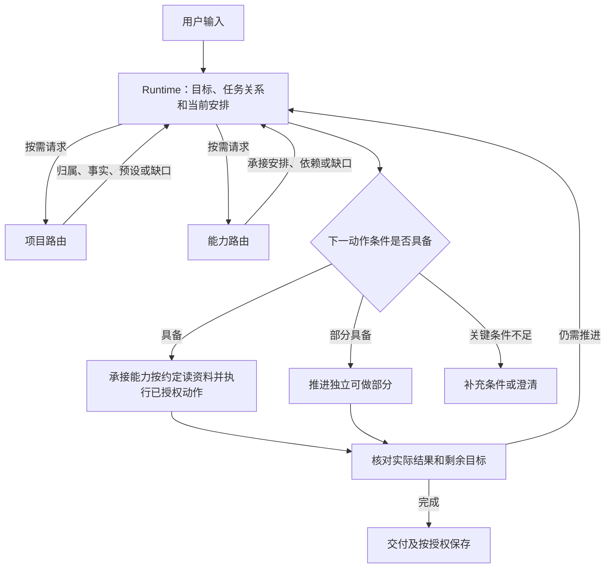

# KSF 核心运行、项目与能力路由协作

本约定由 [ksf-runtime](../../abilities/partners/ksf-runtime/partner.md)组织采用，定义任务上下文、路由交接、缺口传播与整体过程。[项目路由](../../abilities/competencies/project-route/competency.md)持有归属和项目事实方法；[能力路由](../../abilities/competencies/ability-route/competency.md)持有候选选择与依赖方法。承接能力按[资料读取约定](materials.md)准备支持材料。两个路由只向 runtime 返回结果或补充需求，不自行调用另一路由、改变主任务或循环接管。本文定义 Agent 的运行方法，不是程序已经实现的语义调度器。

## 共同上下文与返回

runtime 在当前任务底稿维护唯一一份上下文，不把任务过程存入对象 user-data；跨会话简短续接按[根协作约定](user-collaboration.md)维护 MEMORY，不重复项目检查点，也不在只讨论、只读或不保存时写入：

| 信息 | 最小内容 |
| --- | --- |
| 目标与操作边界 | 目标、交付、完成条件；讨论、读取、修改或发布范围 |
| 协作与短期续接 | 当前根完整读取的 USER/BOT 约定、MEMORY 线索及其核实状态；本次指令覆盖范围 |
| 任务关系 | 新任务、继续、旁问、纠正、暂停、取消或恢复 |
| 主目标与关联 | 项目、知识、能力、档案之一，或无归属／待确定；目标身份、待创建／已存在、关联对象及实际定位。项目事实与工程范围按需准备。 |
| 能力 | 对象精确引用、实际来源/路径、适用理由、必要依赖及读取情况 |
| 资料 | 读取范围、能力约定或本次来源、已读原文、实际采用依据及未知 |
| 下一动作 | 所需方法、事实、工具及当前会话中仍有效的授权 |
| 进展与缺口 | 已完成产物、缺口影响哪些动作、已经尝试的方法及结果 |
| 外部动作 | 未开始、已完成或结果未知；回执与下一次对账方式 |

每个路由向 runtime 返回：结果及依据、发现是否完整、实际读取来源、具体缺口及影响、可继续动作、需要补充的条件。用足以推进工作的段落或表格表达，不要求展示内部字段。区分“无需本项”“结果足够”“部分可用”“需用户决定”和“读取/解析失败”。无项目是可以继续的结果，不等于项目发现失败；无专用对象不等于宿主不能处理；资料缺失不等于事实已否定。

## 完整运行过程

| 阶段 | runtime 的行为与返回条件 |
| --- | --- |
| 0 本地准备 | 核实当前根、固定入口、必要定义和根 USER.md、BOT.md、MEMORY.md 全文；采用对象时按 ID 读 user-data。缺少可选配置用默认；损坏/不可读保留原件和错误。中断事务沿入口恢复规则处理，仍失败只继续独立工作，不绕过活跃事务或假装 KSF 已恢复。启动不检查远程版本、不自动升级。 |
| 1 任务关系 | 合入继续、纠正及范围变化；无关旁问单独处理并保留原恢复点；独立新任务不默认继承旧项目。多任务“继续”不明确时澄清；暂停/取消停止相应后续动作。 |
| 2 项目上下文 | 有指定项目、已有归属或需要项目事实时核对根卡；没有项目线索且任务可独立完成时按无项目继续。归属未知只阻止依赖它的材料使用、判断或写入。 |
| 3 能力安排 | 新选或重选时取得完整发现摘要、排除固定入口，按能力路由的优先规则核对正文、实际来源和当前所需依赖。继续任务复用有效安排，已失效部分才重选。 |
| 4 补齐支持 | 缺项目事实交项目路由；缺资料由承接能力提出具体入口或范围及影响；缺专业方法复核能力安排；缺工具、登录或外部条件直接处理执行条件。不得因缺背景主动检索知识目录。 |
| 5 下一动作 | 内部核对这一步仍服务目标、方法/事实/工具足够、符合当前要求及有效授权、没有需要先对账的未知外部结果。条件具备立即执行，不新增逐步审批或重复确认。 |
| 6 结果与纠偏 | 按实际产物核对成功、部分成功、失败或未知。保留有效成果，只修正受影响安排；工具失败不直接重跑路由，未知外部结果先对账。 |
| 7 交付保存 | 对照全部交付和完成条件；未完成项注明具体影响及恢复条件。任务要求的产物按授权保存，额外长期知识、永久能力和偏好走资产维护；无项目不自动创建根卡或检查点。 |

CLI 不可用时，已明确定位的文件可由宿主工具读取独立事实；不能凭手工目录扫描猜测身份覆盖、依赖绑定或声称全库发现完整。未能取得全部发现时，保留有效结果和缺口，用户指定且能完整核实的能力可以采用，不宣称已完成全局比较。

## 项目分支

| 情况 | 返回与下一步 |
| --- | --- |
| 不需要项目，或完整发现后无相关项目 | 明确无项目继续；长期任务可提出建项目建议，不自动落盘。 |
| 指定项目存在，或有唯一充分匹配 | 读取必要正文确定归属；不能仅凭名称、cwd 或工程路径绑定。 |
| 多个候选、发现不完整 | 返回具体候选、错误和影响；只有会改变材料、客户范围、写入或重要取舍时才澄清；独立工作继续。 |
| 指定项目不存在 | 说明不存在；用户明确要求创建时交资产维护落实，未创建前不声称存在。 |
| 根卡损坏或不可读 | 保留原件，说明缺少哪些事实，不把失败解释为无项目。 |
| 项目归档 | 档案 scope 或原位 archived 默认不选；明确指定时按实际 scope 读取，不自动恢复或改 active。 |
| 工程关联失效、同一工程有多个项目 | 项目事实和工程可用性分别核实；只阻止依赖该工程的动作，不凭工程路径选主项目。 |
| 引用其他项目、切换项目 | 引用不改变主归属；切换后重审受影响范围，不自动继承旧预设和私人资料范围。 |
| 无项目但需要产物 | 在已确定工作区按授权交付，不以缺根卡阻塞；新建实际工程仍沿既有创建规则，不顺带创建项目。 |

一条请求有多个独立交付时，可分别确定各自的主项目或无项目及承接方式，仍由 runtime 核对整体交付；不自动建立多个项目、跨项目协同或真实 Agent。

## 能力分支

优先关系由能力路由持有：当前明确指定 → 继续任务中有效的原安排 → 适用项目预设 → 全局协同 → 全局搭档 → 通用 Agent。项目预设协同优先于同组搭档，但适用的预设搭档可以优先于全局协同。项目预设不是候选白名单。

正文核对按能力路由的最小顺序执行：本轮需要已明确项目的预设时，根卡和逐项检查先于预设正文，预设不适用、失效或覆盖不足才核对全局候选正文。完整全局摘要可提前取得，不把摘要排列当作正文核对或采用顺序。核对顺序、实际选择、方法使用分别验收；候选读取不等于采用，正确产物也不抵消已证实的过程违规。

替代安排由能力路由连同原预设问题、影响和实际替代返回 runtime；runtime 在采用前向用户简短说明。中途说明可以满足该义务，最终产物继续遵循用户格式；仅有工具错误输出不算通知。无异常不强制展示路由报告，不新增数据库、默认设置或逐步确认。

| 情况 | 返回与下一步 |
| --- | --- |
| 用户指定且适用可用 | 按正文、精确来源和依赖承接。仅提及对象或要求审阅它不等于指定采用。 |
| 指定不适用或不可用 | 给实际原因和具体替代；“只用该能力”等硬约束不能自动绕过，等待的仅是依赖该选择的动作。 |
| 项目预设不适用、缺失、归档或版本不符 | 明确不采用原因，保留配置；可说明替代安排并匹配全局，不把其他版本冒充原预设。 |
| 多个预设可用 | 先协同后搭档，同类按配置顺序核对完整适用性；实质差异无法判断时澄清。 |
| 无协同但有搭档 | 由搭档承接，不要求先造协同。 |
| 无专用对象但宿主足够 | 由通用 Agent 使用现有方法和工具处理，不强制创建永久能力。 |
| 方法或专业依据不足 | 明确真正缺口，取得支持或调整方案；不能靠角色名称声称具备能力。 |
| 对象只覆盖部分交付 | 分拆承接或组合已有能力，保留未覆盖部分，不缩减原目标。 |
| 协同必需角色或基本功缺失 | 当前安排不完整；可推进独立阶段，不声称整个协同已正常执行。不通过临时改写其正文绕过。 |
| 补充基本功/数据包缺失 | 判断下一动作是否依赖它；不依赖则继续，依赖则补齐或调整方法。 |
| 对象可读但工具、权限或登录不可用 | 处理执行条件，不反复匹配同一对象。合法等效办法可在已授权范围采用，不伪称原工具已执行。 |
| 多源同 ID、来源失联或损坏 | 按明确来源解析或澄清，返回有效部分和完整性限制；不按排列、最高版本猜测，不静默回退坏副本。 |
| 定义或必要依赖变化 | 核实影响，重读受影响定义并按需重选，保留有效产物。 |

项目补充方法和数据包不替代所选对象的原始依赖。源对象仍绑定同源/Core；不能拿个人覆盖或别的源补齐其声明依赖。只读候选不注入个人设置，实际采用再按对象 ID 读取。

## 资料读取与采用

承接能力按[公共资料读取约定](materials.md)确定资料的用途、入口或限定目录、读取条件和缺失处理。常规任务只使用本次输入或指定材料、项目入口指向的必要事实、已采用能力明确约定的资料，不设独立知识路由。

| 情况 | 处理 |
| --- | --- |
| 输入和已有资料足够 | 直接推进，不扫描知识目录补背景。 |
| 项目事实不足 | 沿根卡、检查点、工程和明确来源准备；方法论链接不自动变成方法入口。 |
| 能力声明配套资料或数据包 | 按精确对象及有效位置核对入口，再按当前步骤下钻；不全量装载。 |
| 能力只有部分资料、来源不可读或冲突 | 说明具体缺口、适用条件和影响；保留原件，继续不依赖缺口的动作。 |
| 专业方法不足 | 复核能力安排或明确缺口，不以扫描知识库代替方法设计。 |
| 无专用对象 | 通用 Agent 使用输入、项目事实、指定材料与宿主工具，不强制创建能力。 |
| 用户明确要求知识查阅、讨论或依据知识设计能力 | 在该任务范围沿实际知识入口和相关原文读取；可由适用能力或通用 Agent 承接。 |
| 用户明确要求记录、补充、修订、归位建议或结构整理 | 采用 knowledge-organize；人主导内容，适用能力按要求提炼，资产维护落实已授权记录。只建议位置时零写入，保留实例框架。 |

事实、来源观点、推断和已确认项目选择分开；时效、版本、冲突和材料指令边界按公共约定核对。知识根导航、不同框架、认知模板和知识正文保留，读取不自动触发保存或采纳。

## 缺口如何传播

下一动作所需条件全部具备才执行；缺口只阻止依赖它的动作，路由错误不直接等于整个任务失败。

| 组合 | 处置 |
| --- | --- |
| 无项目、能力可用、输入足够 | 直接完成。 |
| 无项目、无专用对象、宿主足够 | 通用 Agent 完成，不创建项目或能力。 |
| 预设失效、全局有替代 | 说明失效及替代理由，继续适用工作。 |
| 归属待定、用户指定文件可独立处理 | 仅在授权文件范围处理，不绑定项目。 |
| 能力可用、缺关键客户事实 | 补事实；可先做框架，不编造完整结论。 |
| 资料足够、缺工具 | 保留依据，找可行工具或交付可准备部分。 |
| 工具可用、仅授权讨论 | 交付方案，不执行修改。 |
| 一项交付受阻 | 推进独立交付，明确整体仍有未完成项。 |
| 安排失效、成果有效 | 保留成果，仅替换失效安排。 |
| 只有用户能决定 | 给具体问题、推荐及影响，等待该决定；其他独立工作继续。 |
| 外部结果未知 | 先对账，不盲目重复发送、发布或其他副作用。 |
| 所有关键路径缺必要条件 | 交付已知结果、具体阻碍及恢复条件，不声称完成。 |

三种优先关系分别处理：能力选择按当前要求/有效安排/预设/全局；对象字段值按本次明确值/该对象保存值/对象默认；事实按来源、时间、版本、适用范围及实际结果核实。不能用“某个文件优先”证明事实为真。

## 重规划、暂停与恢复

| 新变化 | 复核范围 |
| --- | --- |
| 措辞、格式或局部产物修改 | 保留安排，继续执行。 |
| 项目归属变化 | 项目事实及受影响的预设、资料、能力。 |
| 目标或交付实质变化 | 能力适用性及必要上下文。 |
| 新资料只增加例证 | 补依据，不重选能力。 |
| 证据推翻重要前提 | 受影响决定、方法和动作。 |
| 工具暂时失败 | 先处理工具，不全量重跑路由。 |
| 对象定义、来源或依赖改变 | 受影响定义及步骤。 |
| 换 KSF 根或新会话恢复 | 重读当前入口及必要记录，重新核实事实与有效授权。 |

每次请求补充或重选都说明新信息、具体缺口和对下一动作的影响。相同输入和方法没有进展时，不在路由之间反复交回；使用可行的新方法、取得材料或提出具体澄清。无需靠固定重试次数代替判断。

用户暂停/取消时停止相关动作，只有已有保存授权才写检查点。恢复沿[任务检查点](task-checkpoints.md)核对根卡、产物、精确定义、最新要求与有效授权；已完成和取消任务不自动重开。无项目临时任务保留在会话，要求保存但落点不明时先确定唯一位置。按需读取不能清除同一 Agent 先前上下文，不宣称实现物理隔离。

## 实现、兼容与证据

项目的可选 routing 结构见[项目 CLI](../cli/project.md)和[配置模板](../templates/project-routing.md)。程序只检查四类能力预设的结构、精确引用和来源，不判断任务适用性、不注入 user-data、不安装依赖、不选择能力。旧项目没有 routing 时行为不变；坏配置保留原文和可用项，不能阻止读取其他项目事实。

项目创建、导入、整理和补全是显式任务处理，由 runtime 按[project-intake](../../abilities/competencies/project-intake/competency.md)组织专业安排。项目路由只准备归属和缺口，资产维护落实已有授权内的保存；不增加另一条路由，也不在每轮发现缺字段时自动导入或补写。接入完成不自动扩展到后续业务动作。

项目预设是偏好，不成为 Core 升级的新硬依赖；升级或切换后重新采用时检查，报告失效而不自动改配置或冒充其他版本。能力源的升级兼容性检查保持其既有规则。

验收按无项目、项目判断、预设与全局匹配、能力缺口、资料缺口、协调返回、任务延续、执行及资产边界分组。程序测试证明确定性接口；当前 Agent 走查记录实际输入、调用、采用理由和产物；独立新会话与真实任务证据另行记录。状态、预期案例和文档存在均不等于已通过验证。

知识与档案的组织维护采用 [Core 默认设计机制](../content-design.md)及实例根说明；明确知识任务或能力约定的文件可直达，在声明范围按需导航；维护/重组前核对规则。档案项目由项目路由在明确追溯时发现，资产维护负责归档、恢复及入口复核，读取不产生迁移授权。

## 独立知识路由退役与旧配置

Core 已移除 knowledge-route 定义和固定保护映射，runtime 不再引用或调度。旧能力仍精确引用该对象时按普通缺失错误返回，不自动替换；旧 user-data 与历史记录保留。

routing 只支持 cooperations、partners、competencies、data_packages。旧 routing.knowledge 在 read/list 中原样保留，check 返回 PROJECT_ROUTING_KNOWLEDGE_REMOVED，不访问其目标；新增或修改 routing 拒绝该字段。正文及无关元数据维护可保留未变旧值；归档/恢复必须先清理旧字段，失败不产生部分移动。程序不自动迁移项目、不新增替代字段。

## 四类主要目标

Runtime 按明确主要目的选择一个主目标；关联对象不建立聊天归属。项目事实仍由项目路由准备，能力选择仍由能力路由负责。知识维护采用知识组织，能力建设核对被维护对象及来源后选择设计职责，档案维护读取实例根规则并采用资产维护。维护目标不等于采用能力，不按文件写入或目录猜测主目标；顺带保存与自动对话归档不切换目标。

目标明确但尚未落成可登记待创建身份，回执采集后跨轮／跨聊天复用；资产创建成功后按预期版本明确绑定，保留历史快照。尚未确定具体目标仍为待确定。已有项目的持续工作优先保留项目归属，ksf-develop 的 Core 开发不自动重归其他类型。本轮只支持四类目标，无收件箱或系统分支。字段与恢复契约见 [task CLI](../cli/task.md)。
