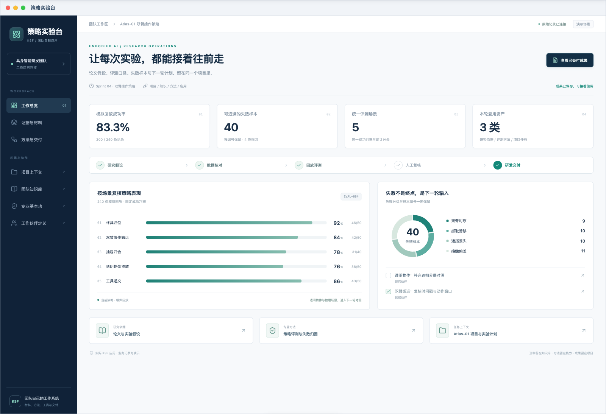
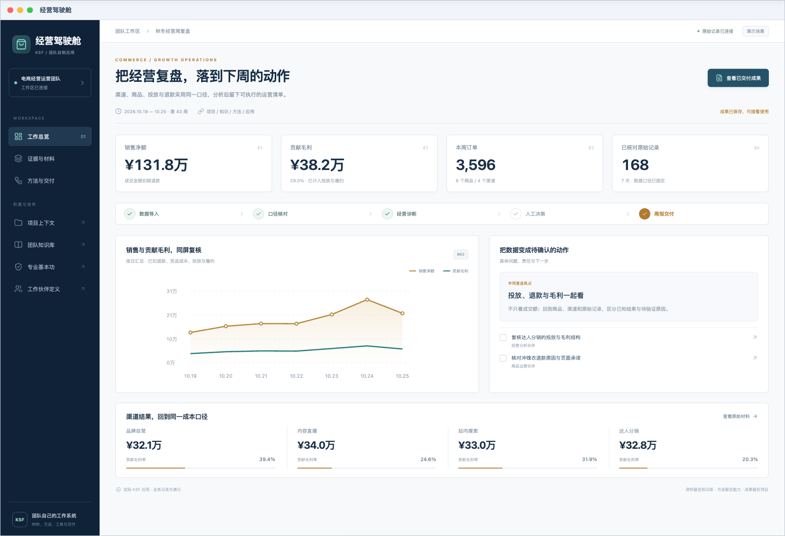
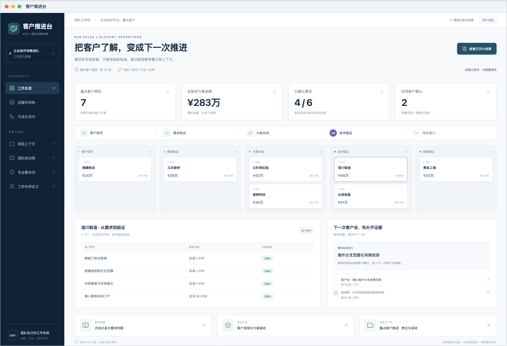

# 三个团队的 KSF 场景演示

[返回根 README](../../../README.md)

这些画面拍摄于 Core 0.3.5 的隔离实例，三款专用应用使用 KSF SDK v1 实际构建、安装和运行，版本均为 0.1.4。团队、客户、访谈、商机与业务数字均为演示数据，专用应用不是 Core 官方预装业务应用。

每个场景都包含实际项目、知识原文、基本功、工作伙伴定义、业务应用和四类桌面卡片。卡片透明呈现，复用宿主的毛玻璃材质。

## 具身智能研发团队

以 Atlas-01 双臂操作策略为例，将研究假设、评测口径、回放记录和下一轮对照计划接在一起。策略实验台从 240 条固定模拟回放计算 5 个场景的结果；复核后保存评测报告、输入摘要和失败分类。模拟数字不代表真实模型或机器人性能。

原图：[完整工作台与卡片](assets/readme/scenes/embodied-desktop.png) · [研发知识地图](assets/readme/scenes/embodied-knowledge.png) · [策略评测基本功](assets/readme/scenes/embodied-method.png) · [已保存评测报告](assets/readme/scenes/embodied-report.png)

## 电商经营运营团队

经营驾驶舱读取 7 天、4 个渠道、6 个商品的 168 条本地记录，以同一口径核对销售、退款、货品成本、投放与履约。销售净额为成交金额扣除退款；贡献毛利再扣除货品、投放和履约成本，不代表财务净利润。复盘后保留周报、行动、负责人和后续检查项。

原图：[完整工作台与卡片](assets/readme/scenes/commerce-desktop.png) · [指标口径与核对材料](assets/readme/scenes/commerce-knowledge.png) · [经营复盘基本功](assets/readme/scenes/commerce-method.png) · [已保存经营周报](assets/readme/scenes/commerce-report.png)

## 企业软件销售团队

客户推进台包含 7 个虚构商机，以澄川制造的企业知识平台评估为例，将客户访谈、需求依据、验收要求、待确认问题和跟进事项接在一起。会前简报从现有记录生成；生成简报不会改变商机阶段，也不表示成交。

原图：[完整工作台与卡片](assets/readme/scenes/sales-desktop.png) · [客户访谈与需求判断](assets/readme/scenes/sales-knowledge.png) · [客户发现基本功](assets/readme/scenes/sales-method.png) · [已保存会前简报](assets/readme/scenes/sales-report.png)

## 实机范围与定制入口

三款演示应用提供主窗口与概览、待办、工作积累、交付四类卡片，共 12 张。待办可在卡片上更新；资料入口可打开当前 KSF 文件；在实际窗口确认后生成的 Markdown 成果，可由交付卡片重新打开。输入与报告的文件摘要经过核对。

图表由结构化演示数据确定性计算，未执行外部模型、训练、机器人、电商或 CRM 平台调用。README 描述的 Agent 用法，由宿主采用项目背景、知识和能力定义来完成。

应用怎样开发、安装与分享，见[应用开发手册](app-development/README.md)、[桌面卡片](app-development/cards.md)、[打包与分发](app-development/release.md)。可复用职责和方法见[能力手册](handbook/abilities.md)。
