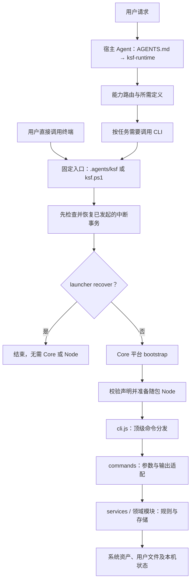

# KSF 系统基础架构

本目录面向维护 KSF 程序、存储和发行机制的开发者，说明当前实现如何连接、状态由谁持有、修改时应检查哪些边界。具体命令参数由 [CLI 索引](../cli/index.md)持有，启动和发行的精确协议分别由[固定入口](../../runtime/launcher.md)与[发行说明](../distribution.md)持有。

文中的目录和终端示例均以当前 KSF 根为基准。Core 开发源是 `ksf-core`；用户实例可以叫 `ksf` 或其他名称。实例名称不参与程序版本身份。当前系统和 Node 版本读取 [manifest](../../manifest.yaml)，不在本目录另行维护版本常量。

## 组成与调用关系

KSF 有两条相互协作的执行路径。Agent 读取 `AGENTS.md` 和搭档定义，理解用户目标并选择工作安排；基础程序提供确定性的读取、校验、写入和生命周期操作。搭档定义由宿主 Agent 执行，CLI 不在后台自动创建或运行搭档。

Windows 当前实现到固定入口的独立恢复和 Core 转交契约；图中的 Windows bootstrap、Node 和后续业务 CLI 尚未接入。`hello`、`build`、`test`、`runtime verify` 等简单命令由 cli.js 直接处理，其他命令按各自适配层分发。普通启动只准备本地环境和恢复已发起事务，不检查远程版本或自动升级。

## 目录与所有权

| 位置 | 持有内容 | 生命周期与归属 |
| --- | --- | --- |
| 根 `AGENTS.md` | Agent 运行入口 | 系统管理，发行与升级按基线处理 |
| `.agents/ksf`、`.agents/ksf.ps1` | 原生启动、恢复与 Core 转交 | 位于 Core 外，保持小而稳定；变化时仍可随发行更新 |
| `.agents/core/abilities/` | 系统工作流、搭档、基本功和数据包 | 随 Core 发行；业务定义规则见对象文档 |
| `.agents/core/runtime/` | bootstrap、JavaScript 程序、随包 Node 压缩包及测试 | 随 Core 发行，已安装 Node 位于 runtime-data |
| `.agents/core/docs/` | 系统规范、命令契约及维护说明 | 随 Core 发行，本目录属于这一层 |
| `.agents/core/distribution/` | 用户模板源和模板同步工作流源 | 由发行程序生成用户模板 |
| `.agents/runtime-data/` | 本机运行时、锁、检查记录、事务、备份、贡献计划和构建输出 | 本机状态，默认不进入 Git；不同子项有不同清理条件 |
| `.agents/user-data/` | KSF 程序自身的用户设置和必要状态，含 settings 与本地 identity | 用户实例所有，可备份迁移；Core 不收录个人值，升级回滚不覆盖 |
| `项目/`、`知识/`、`能力/`、收件箱、源档、归档 | 用户正常工作产生的正式内容 | 归用户空间，不放进 user-data 或 Core |

Core 源码与用户实例采用不同的忽略规则。Core 忽略真实用户数据；用户模板允许正式个人内容及 user-data 入库，排除 runtime-data 和相应临时文件。Git 忽略规则不等于网盘同步规则，也不能清除已经提交的历史内容。

## 几个相似名称

| 名称 | 实际含义 |
| --- | --- |
| `ksf-runtime` | 固定入口搭档，由宿主 Agent 履责；不是 Node 进程或后台服务 |
| `core/runtime` | 可发行的程序与运行时准备代码 |
| `runtime-data/runtime` | 当前设备上已准备的 Node 安装和安装状态 |
| `docs/system` | 本套架构和维护文档 |
| `ksf system ...` | 版本读取、检查、升级、显式同步和回滚命令 |
| `runtime-data/system` | 生命周期命令与入口共同使用的本机事务、检查记录及备份 |

## 阅读与修改入口

1. [启动器与运行时](launcher-runtime.md)：先分清原生入口、Core bootstrap 和 Node 的边界。
2. [CLI 分层](cli.md)：定位参数适配、业务服务和存储实现，了解如何新增命令。
3. [本机运行数据](runtime-data.md)：核对状态生产者、恢复依赖及清理条件。
4. [系统级用户数据](user-data.md)：判断哪些值应随用户迁移，如何注册和消费。
5. [构建、发行与系统生命周期](lifecycle.md)：理解生成清单、发行基线、升级恢复及贡献来源。

每篇均列出源码和已有测试。修改命令时同步 CLI 契约；修改启动、事务或数据格式时同步其所属规范和相关测试；涉及系统文件的变更通过既有 build 刷新生成摘要。结构检查、测试通过和真实平台验证分别记录。

## 实现与验证来源

程序入口见 [cli.js](../../runtime/src/cli.js)，身份与管理范围见 [products.js](../../runtime/src/distribution/products.js)，Agent 行为入口见 [ksf-runtime](../../abilities/partners/ksf-runtime/partner.md)。

跨模块验证见 [lifecycle.test.js](../../runtime/tests/lifecycle.test.js)、[minimal-runtime.test.js](../../runtime/tests/minimal-runtime.test.js)；各专题链接更细的测试。本目录介绍现有架构，不表示 Windows 完整业务 CLI、Linux 支持、自动同步用户数据或长期运行效果已验证。
